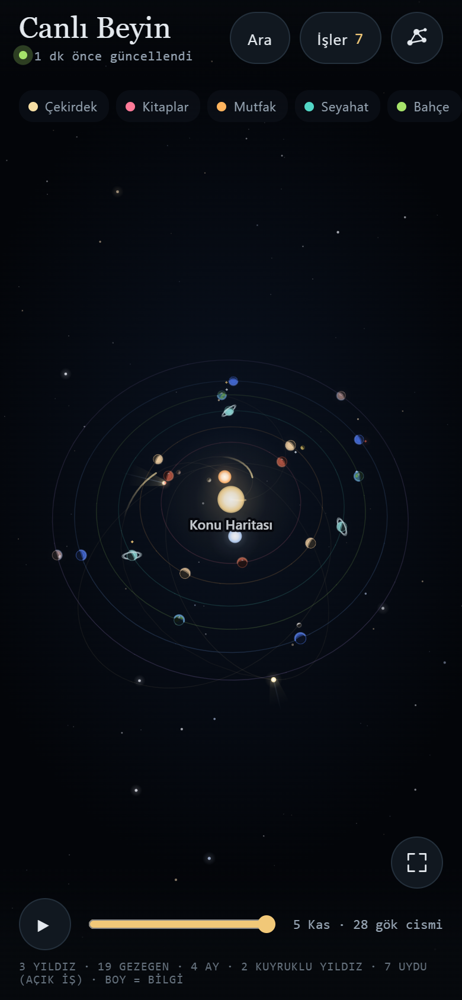
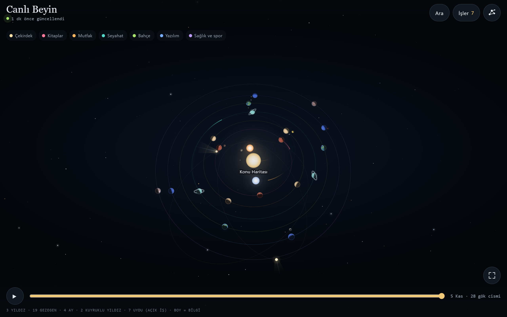

# Canlı Beyin

Markdown notlarını yaşayan bir haritaya çeviren tek sayfalık görselleştirme. Her not bir **nöron** ya da **gezegen**,
her `[[bağlantı]]` bir **sinaps** ya da gezegenler arası rota. Telefonda parmakla, bilgisayarda fareyle gezilir.

| Nöral görünüm | Yörünge görünümü | Masaüstü |
|---|---|---|
|  |  |  |

Ekran görüntüleri `ornek/notlar` içindeki **uydurma** örnek notlardan üretildi.

## Hemen dene

1. Depoyu indir (yeşil **Code** düğmesi → **Download ZIP**, ya da `git clone`).
2. `index.html`'i tarayıcıda aç. Hepsi bu: sunucu, kurulum, internet gerekmez.

## Kendi notlarınla

Python 3.9+ yeter (ek paket yok):

```
python uret.py <notlarının-klasörü>
```

Bu, `index.html`'in yanındaki `veri.js`'i yeniden yazar; sayfayı yenile.

### Not klasörü nasıl olmalı

```
notlarim/
├── beyin.json        # ayarlar (isteğe bağlı)
├── gorevler.json     # açık işler (isteğe bağlı)
├── bitenler.json     # son bitenler (isteğe bağlı)
├── index.md          # her .md bir not
├── ekmek.md
└── arsiv/
    ├── ekmek-gecmis.md   # "<ad>-gecmis" → o notun ayı
    └── gunluk.md         # arşivdeki öteki notlar → kuyruklu yıldız
```

Bir not:

```markdown
---
alan: mutfak            # hangi kümede/yörüngede duracağı
guncelleme: 2026-11-04  # yoksa dosya tarihi
---

# Ekşi Maya Ekmeği

Bağlantı böyle: [[fermente]] · bir bölüme: [[ilkeler#Yazma]]
```

`beyin.json`:

```json
{
  "baslangic": "2026-08-21",
  "cekirdek": ["index", "ilkeler", "guncel"],
  "gunes": "index",
  "nabiz": "guncel",
  "alanlar": [
    {"anahtar": "cekirdek", "ad": "Çekirdek"},
    {"anahtar": "mutfak", "ad": "Mutfak", "renk": "#FF7A98", "gezegen": "mars"}
  ],
  "gizle": ["gizli-kelime", "\\b\\d{11}\\b"]
}
```

| Alan | Anlamı |
|---|---|
| `baslangic` | zaman cetvelinin ilk günü (yoksa en eski tarih) |
| `cekirdek` | merkezdeki notlar (nöral görünümde ortada, yörüngede yıldızlar) |
| `gunes` / `nabiz` | yörüngede güneş olacak not / açılışta ışıldayan not |
| `alanlar` | sıra = yörüngelerin içten dışa sırası. `renk` ve `gezegen` verilmezse sırayla krem Satürn, kızıl Mars, turuncu Jüpiter, turkuaz Uranüs, yeşil Dünya, mavi Neptün, mor Plüton, gri Venüs |
| `gizle` | sayfaya taşınmadan `••••••` ile kapatılacak düzenli ifadeler. API anahtarı / jeton kalıpları zaten her zaman kapatılır |
| `durumlar` | iş gruplarının adları, ör. `[["oncelik","Öncelikli"],["bende","Bende"],["sende","Sende"],["dista","Dışarıdan"],["askida","Askıda"]]` |

`gorevler.json` (yörüngede notunun çevresinde yapay uydu olur; öncelikli altın, 21 günü geçen kırmızı):

```json
[{"no": 1, "baslik": "Lizbon konaklaması", "durum": "sende", "oncelik": true,
  "son": "2026-11-04", "sayfa": "lizbon-plani", "ozet": "tramvaya yakın olsun"}]
```

## Neler yapılır

- **İki görünüm** (sağ üst düğme, seçim hatırlanır): 3B nöron ağı ↔ güneş sistemi.
- Nota dokun → ayrıntı paneli, bağlantıları; **Oku** → tam metin ve bölümler; içindeki `[[bağlantı]]`lar tıklanır.
- **Ara**: bütün notlarda, Türkçe harf duyarsız (`isik` = `ışık`).
- **İşler**: açık işler ve son bitenler.
- **Zaman cetveli** ▶: hafızanın gün gün büyümesini oynatır.
- **Tam ekran**: 4 saniye dokunulmazsa kamera notlar arasında belgesel turu yapar.
- Yörüngede gezegenler gerçek gezegenlerden esinli vektör dokulu (halkalar, bulutlar, gece yüzünde şehir ışıkları),
  hızlar Kepler'e uyar, ışık güneşten gelir.

## Güvenlik ve gizlilik

- **Dış kaynak sıfır**: kütüphane, yazı tipi, analiz, ağ isteği yok; her şey bu üç dosyadaki kendi kodu.
- Not metni sayfaya HTML olarak değil, kaçışlanarak basılır; notlardaki bağlantılar yalnız `http(s)`.
- `veri.js` **notlarının tamamını içerir.** Kendi notlarınla ürettiğin `veri.js`'i herkese açık bir yere koyma ya da
  depoya gönderme; özel tutmak için `python uret.py notlarim -o ozel/veri.js` gibi ayrı bir yere üretip
  `ozel/`i `.gitignore`'a ekleyebilir, sonra `index.html`, `beyin.css`, `beyin.js`'i de oraya kopyalayabilirsin.

## Dosyalar

| Dosya | Ne |
|---|---|
| `index.html` | sayfa iskeleti |
| `beyin.css` | görünüm |
| `beyin.js` | çizim ve etkileşim (Canvas 2D, ~1.600 satır) |
| `veri.js` | `uret.py`'nin ürettiği veri (depodaki örnek notlardan) |
| `uret.py` | Markdown klasörü → `veri.js` |
| `ornek/notlar/` | uydurma örnek not bahçesi |

## English (short)

A single-page, dependency-free visualisation of a Markdown note vault (Obsidian-style `[[links]]`) as a 3D neural
network or a solar system. Open `index.html` to see the sample; run `python uret.py <your-notes-folder>` to build
`veri.js` from your own notes. The UI is in Turkish. `veri.js` contains the full text of your notes — keep it private.

## Lisans

MIT — bkz. [LICENSE](LICENSE).
