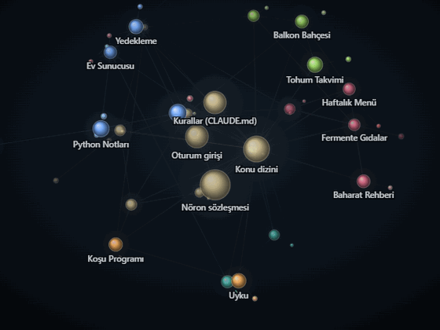
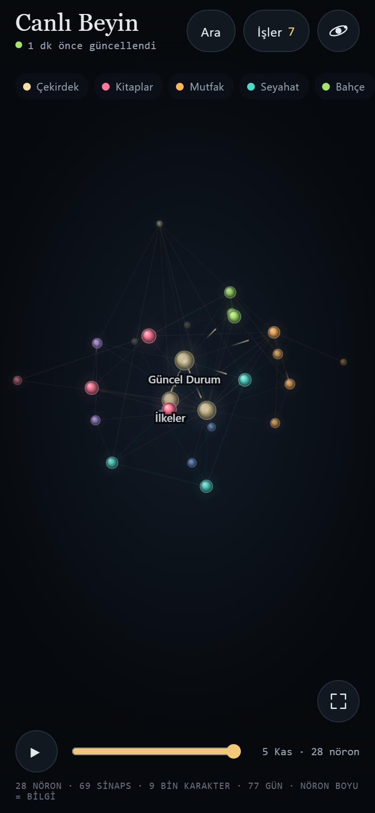
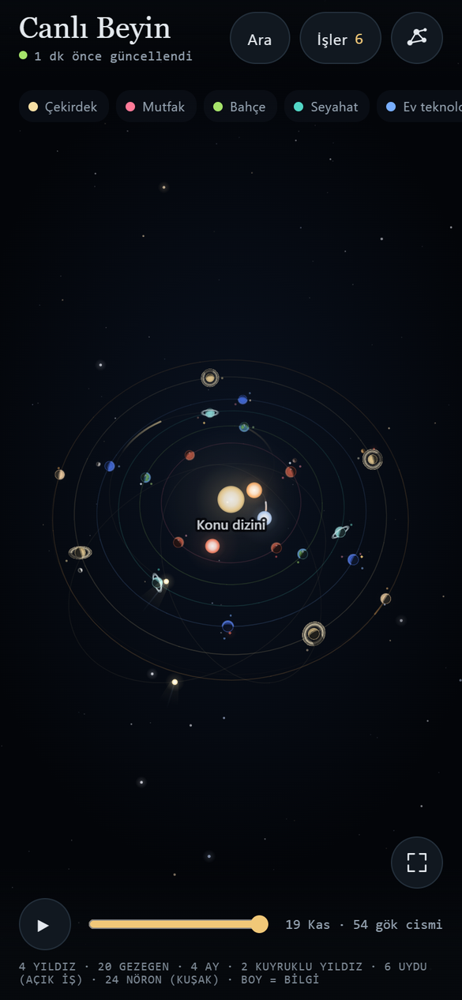
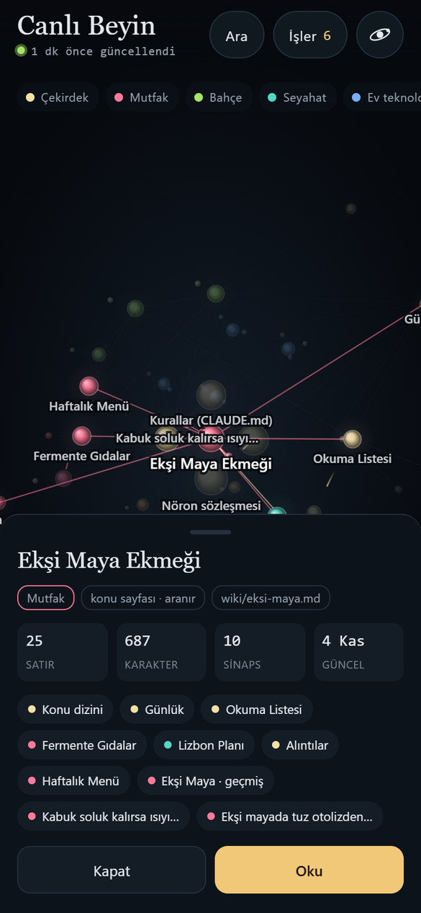
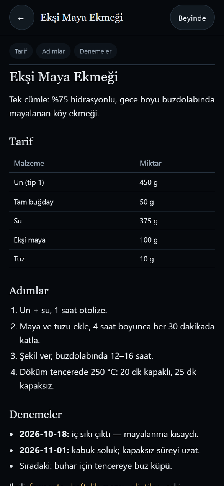

# Canlı Beyin

**Claude Code için kalıcı hafıza — ve o hafızayı yaşayan bir beyin olarak gösteren tek sayfa.**

Claude Code oturumları birbirini hatırlamaz. Canlı Beyin onlara ortak, kalıcı bir hafıza verir: kurallar ve
yaşanmış tuzaklar küçük kartlar (**nöron**) hâlinde tutulur ve kullanıcının cümlesiyle **kendiliğinden** bağlama
girer. Aynı hafıza tarayıcıda 3B bir nöron ağı ya da bir güneş sistemi olarak gezilir.



**Canlı demo:** <https://barbiceps-md.github.io/canli-beyin/> — yalnız uydurma örnek notlarla (ekmek, balkon
bahçesi, Lizbon gezisi, ev sunucusu). Kurulum gerekmez; telefonda da çalışır.

| Nöral görünüm | Yörünge görünümü | Nota dokununca | Okuyucu |
|---|---|---|---|
|  |  |  |  |

---

## Hangi sorunu çözüyor

Uzun süre aynı asistanla çalışınca üç şey bozulur:

1. **Unutma.** Her oturum sıfırdan başlar; dün konuşulan kural bugün yine çiğnenir.
2. **Şişme.** Her şeyi tek bir "hafıza dosyasına" yazınca dosya yüzlerce satıra çıkar, her oturumda baştan okunur,
   asıl kural gürültüde kaybolur. (Hafıza çekirdeğinin doğduğu kurulumda ölçüldü: oturum başı sabit yük
   ~9.900 token, bir soruya cevap için ~21.000 token daha.)
3. **Bayatlama.** Elle yazılan durum ("yedek koştu", "12 kayıt var") bir hafta sonra yalandır.

Canlı Beyin'in cevabı: **hafıza atomik kartlardan oluşur, kartlar aranmaz — ateşlenir; ölçülebilen şey yazılmaz,
ölçülür.** Aynı kurulumda sonuç: oturum başı ~3.600 token, soru başına ~430 token, kart başına ortalama 22 satır.

## Nasıl çalışıyor

```
 kullanıcının cümlesi ──► [UserPromptSubmit kancası] ──► beyin ates ──► ⚡ eşleşen nöronlar bağlama girer
 oturum açılınca ───────► [SessionStart kancası] ─────► ölçülen DURUM + son 72 saat + açık işler
 oturum bitince ────────► [Stop kancası] ─────────────► kasa git'e sürümlenir, sağlık denetlenir
 istediğin an ──────────► beyin-canli ────────────────► kasa → canlı beyin sayfası (3B ağ / güneş sistemi)
```

**Nöron.** Bir olgu = bir Markdown dosyası; gövdesi en çok 24 dolu satır. Başında ne zaman hatırlanacağı yazar:

```markdown
---
id: fermente-kapak-sikilmaz
tur: kural                      # kural | ders (tuzak) | olgu
guncelleme: 2026-10-05
gecerlilik: kalici              # ya da son kullanma tarihi
tetik: fermente, kavanoz, turşu # bu sözler geçince nöron ateşlenir
bag: ayrinti=fermente           # türlü bağ: ayrinti, onkosul, gerekce, celisir, yerine-gecti…
---
# ⛔ Fermente kavanozunun kapağı asla tam sıkılmaz
```

**Ateşleme (iki kademe).** Her istemde `beyin ates` cümleyi nöronların tetikleriyle karşılaştırır. Türkçe için
özel iş yapılır: tetik kelime başında eşleşir ve ek alabilir (`fiyat` → `fiyatını`), ünsüz yumuşaması hesaba
katılır (`yedek` → `yedeği`), `İ/ı` doğru katlanır; nadir söz ağır, her yerde geçen söz hafif sayılır. Emin olunan
en çok 3 nöron gövdesiyle (`⚡ ───`), sıradakiler yalnız başlığıyla (`🧭 Belki ilgili`) gelir; başlığında
"asla / yasak / önce onay" geçen **sert kural** her zaman gövdesiyle gelir. Eşleşme yoksa bağlama hiçbir şey
eklenmez — bedava.

**Anlam katmanı (isteğe bağlı).** İnsanlar tetik sözünü birebir yazmaz. `hafiza/bin/beyin-anlam` yerel, çok
dilli bir dil modeliyle (BAAI/bge-m3) mesajı nöronlarla **anlamına göre** de karşılaştırır; hiçbir metin makineden
çıkmaz. Anlam yalnız **ekler**: tetiğin getirdiğini asla düşürmez. Ölçümde (çekirdeğin doğduğu kasada, dokunulmamış
sınav kümesi) tetik sözü geçmeyen doğal cümlede hedef kural %29'dan gövdeyle %51'e, gövde ya da başlıkla %79'a
çıktı; güvenlik kurallarında recall %100 kaldı. Servis yoksa her şey tetik yoluyla, birebir aynı çıktıyla yürür.

**Ölçülen durum.** `durum` komutu her çağrıda ölçer, hiçbir yere yazmaz: kasa en son ne zaman sürümlendi,
kaç açık iş var, kaç nöron bayat, ateşleme ne sıklıkta işe yarıyor. Ölçemediğini "?" değil uyarı olarak basar.

**Canlı Beyin görünümü.** `beyin-canli` kasayı tek bir statik sayfaya çevirir (kütüphane yok, ağ isteği yok):

- **Nöral görünüm** — çekirdek ortada, konu sayfaları kabukta, arşiv dışta; nöronlar kaynak sayfalarının
  çevresinde küçük kürecikler. Sinapslar boyunca ışık sinyalleri süzülür; dokunduğun not ve komşuları ateşlenir.
- **Yörünge görünümü** — konu dizini güneş, her alan bir yörünge, her konu sayfası gerçek gezegenlerden esinli
  vektör dokulu bir gezegen (halkalar, bulutlar, gece yüzünde şehir ışıkları; hızlar Kepler'e uyar). Nöronlar
  gezegenin çevresinde asteroit kuşağı, açık işler yapay uydu (öncelikli altın, 21 günü geçen kırmızı),
  `<ad>-gecmis` arşivleri ay, öteki arşiv kayıtları kuyruklu yıldız.
- **Zaman cetveli** hafızanın gün gün büyümesini oynatır · **Ara** bütün notlarda Türkçe harf duyarsız arar
  (`isik` = `ışık`) · **İşler** açık işler ve son bitenler · **Tam ekran**da 4 sn dokunulmazsa kamera notlar
  arasında belgesel turu yapar.
- Telefonda parmakla, bilgisayarda fare ve klavyeyle: oklar döndürür, `+`/`−` yakınlaştırır, `/` arar, `Esc` kapatır.
- Bağlantıyla açılış: `?gorunum=yorunge` · `?ac=<not-kimliği>` (ör. [`?ac=eksi-maya`](https://barbiceps-md.github.io/canli-beyin/?ac=eksi-maya)).

Hafıza şart değil: görünüm **herhangi bir Markdown klasörünü** de (Obsidian tarzı `[[bağlantı]]`lı) okur.

## 5 dakikada başla

**1. Yalnız bakmak:** [canlı demo](https://barbiceps-md.github.io/canli-beyin/) ya da depoyu indirip
`docs/index.html`'i tarayıcıda aç.

**2. Kendi Markdown notlarınla** (Python 3.8+, ek paket yok):

```bash
python canli/uret.py ~/notlarim --sayfa ~/canli-ozel
# ~/canli-ozel/index.html'i tarayıcıda aç
```

**3. Claude Code hafızası olarak** (Linux / macOS / WSL; Windows'ta Git Bash — bkz. [Windows](#windows)):

```bash
git clone https://github.com/barbiceps-md/canli-beyin.git ~/canli-beyin
cd ~/canli-beyin
./kur.sh --ornek          # --ornek: kasaya uydurma örnek kasayı koyar; nasıl çalıştığını gör
```

`kur.sh` komutları bağlar (`beyin`, `durum`, `beyin-canli`), kasayı `~/beyin`'e kurar (beyaz liste
`.gitignore` + git), üç kancayı `~/.claude/settings.json`'a ekler (eskisinin kopyası `.beyin-oncesi` olarak kalır)
ve testleri koşar. Sonra:

1. `ornek/CLAUDE-ornek.md`'deki bölümü kendi `CLAUDE.md`'ne ekle.
2. Yeni bir Claude Code oturumu aç — bağlamda **"DURUM —"** bloğunu görmelisin.
3. "veritabanından şu kaydı sil" yaz — örnek kural kendiliğinden gelmeli (`⚡ 1 nöron ateşlendi`).
4. `beyin-canli` — hafızanın canlı görünümünü üretir, açılacak dosyanın yolunu basar.
5. Kendi nöronlarını yaz (`beyin yeni <id>`), örnekleri sil, `beyin saglik` yeşil kalsın.

Kasayı yedeklemek için ona bir uzak depo ekleyebilirsin; oturum sonu kancası her oturumda sürümler ve push eder.
**O depo özel olmalı** — hafızan orada. Haftalık, sır taramalı temiz yedek: `hafiza/ek/haftalik-yedek.sh`.

### Windows

Git for Windows (Git Bash) + Python 3.8+ ("Add to PATH" işaretli) yeter. Git Bash'te aynı üç satır:
`git clone …`, `cd ~/canli-beyin`, `./kur.sh --ornek`. `kur.sh` Windows'u tanır: `python3` Mağaza kısayoluna
düşüyorsa ara katman yazar, komutları sarmalayıcı olarak kurar, kancaları `bash.exe` + `hafiza\windows\kanca.sh`
ile bağlar. Ayrıntı ve haftalık yedeğin zamanlanması: [`hafiza/windows/OKU.md`](hafiza/windows/OKU.md).
Hafıza bir Linux sunucuda, Claude Code Windows'ta ise: SSH köprüsü [`hafiza/yerel/OKU.md`](hafiza/yerel/OKU.md).

## Komutlar

```
beyin giris          oturuma başla: ölçülen durum + son 72 saat + kısa açık işler
beyin ates <metin>   bağlama uyan nöronları ateşle (dosya yolu verilirse içeriği okunur)
beyin ara <kelime>   her yerde ara — dosya değil BÖLÜM döndürür, Türkçe duyarsız, sıralı ve tavanlı
beyin ekle <not>     oturum notunu gunluk/<tarih>.md'ye ekle (eş zamanlı oturumlar çakışmaz)
beyin is <no>        açık işin satırı + ayrıntısı
beyin yol <id>       nöron + bir sıçramalık komşuları      beyin geri <id>   kim bu nörona bağlı
beyin not <id|yol>   nöronu/dosyayı tam bas                 beyin liste       nöron kataloğu
beyin saglik         doğrulayıcı: boyut, şema, tetik, kırık bağ, bayat, çift id, açık iş satırları
beyin yeni <id>      boş nöron şablonu                      durum             ölçülen güncel durum
beyin-canli          kasadan canlı beyin sayfası (canli/uret.py sarmalayıcısı)
```

Sözleşmenin tamamı (klasörler, nöron biçimi, kurallar, bakım): [`hafiza/NORON.md`](hafiza/NORON.md).

## Depo düzeni

```
kur.sh                 tek kurulum (Linux/macOS/WSL/Git Bash)
hafiza/                hafıza çekirdeği
  NORON.md             sözleşme (kurulumda kasaya kopyalanır)
  bin/                 beyin · durum · beyin-anlam (anlam katmanı) · oturum-ozut.py · beyin-canli
  kancalar/            SessionStart · UserPromptSubmit · Stop
  arsivleme/  cron/    gecelik iş günlüğü · aylık tarihçe · şifreli ham kayıt arşivi (isteğe bağlı)
  windows/             tek bilgisayarda Windows kanca sarmalayıcısı + rehber
  yerel/               ikinci bilgisayar: SSH köprüsü, salt okunur ayna, PC'de anlam servisi
  ek/                  zaman.py (son oturumlar) · islenmemis.py · haftalik-yedek.sh
canli/                 görselleştirme: index.html · beyin.css · beyin.js · uret.py · demo-uret.sh
ornek/kasa/            UYDURMA örnek kasa: 24 nöron, 20 konu sayfası, arşiv, günlük, açık işler
ornek/notlar/          UYDURMA düz Markdown not klasörü (hafızasız kullanım örneği)
docs/                  GitHub Pages demosu (örnek kasadan üretilir) + ekran görüntüleri
test/                  hafiza-testleri.sh (çekirdek) · test_uret.py (üretici) · isabet/ · anlam/
```

### Kasa (hafızanın kendisi — bu depoda değil, senin)

```
~/beyin/
├── NORON.md      sözleşme            ├── is/acik.md       tek açık iş listesi (satır ≤160)
├── konu.tsv      konu → kaynak sayfa ├── is/ayrinti.md    işlerin hikâyesi (### <no>)
├── kural/ ders/  nöronlar            ├── gunluk/          oturum notları (yalnız eklenir)
├── wiki/         konu sayfaları      ├── arsiv/           eski notlar — yalnız aranır
└── canli.json    canlı görünüm ayarı (isteğe bağlı: alan adları, renkler, gezegenler, gizlenecek kalıplar)
```

`wiki/index.md`'deki her `## Başlık` bir **alan** olur (nöral görünümde renk kümesi, yörüngede bir yörünge);
altındaki `[[sayfa]]`lar o alana girer, nöron rengini `ayrinti=` bağıyla kaynak sayfasından alır.

## Görünümün veri biçimi

`canli/uret.py <klasör>` iki tür klasörü kendiliğinden tanır: içinde `kural/`, `ders/` ya da `NORON.md` varsa
**kasa**, yoksa **düz not klasörü**. Ayar dosyası: kasada `canli.json`, not klasöründe `beyin.json`.

```json
{
  "baslangic": "2026-08-21",
  "alanlar": [{"anahtar": "mutfak", "ad": "Mutfak", "renk": "#FF7A98", "gezegen": "mars"}],
  "gizle": ["gizli-kelime", "\\b\\d{11}\\b"]
}
```

| Alan | Anlamı |
|---|---|
| `baslangic` | zaman cetvelinin ilk günü (yoksa ön bilgideki ve dosyadaki en eski tarih) |
| `bugun` | üretimi bir güne sabitle (demo/örnek için; komut satırında `--bugun`) |
| `alanlar` | ad, renk (`#RGB`/`#RRGGBB`), gezegen (`saturn mars jupiter uranus dunya neptun pluton venus`). Kasada anahtar = `## Başlık`ın sadeleşmişi (`## Ev teknolojisi` → `ev-teknolojisi`); not klasöründe sıra = yörüngelerin içten dışa sırası |
| `gizle` | sayfaya taşınmadan `••••••` ile kapatılacak düzenli ifadeler (ek olarak) |
| `cekirdek` · `gunes` · `nabiz` | yalnız not klasörü: merkezdeki notlar · güneş olacak not · açılışta ışıldayan not |
| `durumlar` | iş gruplarının adları, ör. `[["oncelik","Öncelikli"],["sende","Sende"]]` |

Not klasöründe açık işler `gorevler.json`, son bitenler `bitenler.json`'dan; kasada `is/acik.md` +
`is/ayrinti.md` ve `gunluk/`'ten okunur. Seçenekler: `--sayfa <klasör>` (sayfanın tamamını yazar),
`--kurallar <CLAUDE.md>` (çekirdekte "Kurallar" yıldızı), `--giris` (oturum başı çıktısı), `--sirlar <dosya>`
(bilinen sırlar listesi), `--oturumlar <klasör>`, `--kip kasa|notlar`, `--bugun`.

## Güvenlik ve gizlilik

- **Veri makineden çıkmaz.** Kancalar, ateşleme ve anlam katmanı yereldir; sayfa dış kaynak (kütüphane, yazı tipi,
  analiz, ağ isteği) kullanmaz.
- **Sır hafızaya girmez:** sözleşmenin kuralı; öz çıkarıcı ham kayıtlardaki parolaları maskeler, haftalık yedek
  göndermeden önce sır tarar ve bulursa durur.
- **Görünüm maskeler:** API anahtarı / jeton kalıpları, `PASSWORD = "…"` atamaları, `` `e-posta` / `parola` ``
  çiftleri, parolalı bağlantı adresleri, özel anahtar blokları her zaman; `gizle` kalıpları ve `--sirlar` listesi ek olarak.
- **Not metni sayfaya HTML olarak değil kaçışlanarak basılır;** bağlantılar yalnız `http(s)`, veriden gelen renkler
  doğrulanır.
- ⚠️ **Ürettiğin `veri.js` notlarının tam metnini içerir.** Kendi kasandan ürettiğin sayfayı herkese açık bir yere
  koyma, bu depoya gönderme (`.gitignore` `canli/veri.js`'i ve `ozel/`'i zaten dışarıda tutar).

Güvenlik açığı bildirimi: [`SECURITY.md`](SECURITY.md).

## Testler

```bash
test/tumu.sh                                          # ikisi birden
bash test/hafiza-testleri.sh                          # çekirdek: 68 test, kendi kum havuzunda (örnek kasayla)
python -m unittest discover -s test -p "test_*.py"    # üretici: 19 test
```

Çekirdek takımı gerçek kasana, ayarına ve kayıtlarına dokunmaz; her test bir zamanlar gerçekten yaşanmış bir
hatadan doğdu. Ateşleme isabetini kendi cümlelerinle ölçmek için: [`test/isabet/OKU.md`](test/isabet/OKU.md).

## Tasarım notları (acı çekilerek öğrenilmiş)

- **Aşırı ateşleme, ateşlememek kadar zararlıdır.** Tavansız ilk sürüm bir istemde 27 nöron yükleyip asıl kuralı
  gürültüye gömdü. Tavan var; elenenler adlarıyla listelenir (sessiz kırpma "hepsi bu" diye okunur).
- **Sessiz başarısızlık en pahalı hata türüdür.** Kancalar başaramadığını yüksek sesle söyler.
- **Bakım kancayla zorlanır, kuralla değil.** "Her oturum sonunda commit at" yazılıydı ama uygulanmıyordu; kancaya
  bağlanınca uygulandı.
- **Saklamak ile yüklemek ayrı şeydir.** Ham transkript, gece özeti, aylık tarihçe saklanır ama hiçbiri otomatik
  yüklenmez. Depolama ucuz, bağlam pahalı.

## Katkı ve emek

- **Hafıza çekirdeği** (nöron sözleşmesi, ateşleme, anlam katmanı, ayna, kancalar, testler): **Ceyhun Yaprak**
- **Canlı Beyin görselleştirmesi ve Windows katmanı**, birleşik proje: **barbiceps-md**

Sürüm geçmişi: [`SURUM.md`](SURUM.md).

## Lisans

MIT — bkz. [LICENSE](LICENSE).

---

## English

**Canlı Beyin** ("living brain") is a persistent memory system for Claude Code sessions plus a dependency-free
single-page visualisation of that memory as a 3D neural network or a solar system.

- **Memory core:** knowledge lives in atomic Markdown "neurons" (rules, lessons, facts) with front-matter triggers.
  Claude Code hooks inject the matching neurons into context automatically on every prompt (two tiers: full body
  for confident matches and hard rules, title-only for "maybe relevant"), load a *measured* status + the last
  72 hours of session notes at session start, and version the vault with git at session end. An optional local
  semantic layer (BAAI/bge-m3, nothing leaves the machine) adds meaning-based matches but never removes trigger
  matches. Turkish morphology (suffixes, consonant softening, dotted/dotless i) is handled explicitly.
- **Live view:** `canli/uret.py` turns a vault — or any Obsidian-style Markdown folder — into `veri.js`; open
  `index.html`. Neural view, orbit view (topics as planets, neurons as asteroid belts, open tasks as satellites),
  timeline playback, Turkish-insensitive search, keyboard and touch navigation. No libraries, no network requests.
- **Try it:** live demo at <https://barbiceps-md.github.io/canli-beyin/> (fictional sample data only), or
  `./kur.sh --ornek` on Linux/macOS/WSL/Git Bash for Windows. The UI and docs are in Turkish.
- **Privacy:** `veri.js` contains the full text of your notes — keep the generated page private.

Credits: memory core by **Ceyhun Yaprak**; Canlı Beyin visualisation, Windows layer and the unified project by
**barbiceps-md**. MIT licensed.
